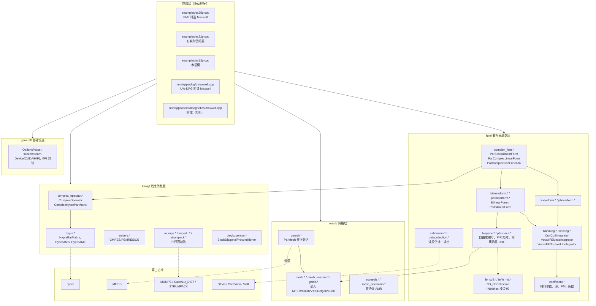
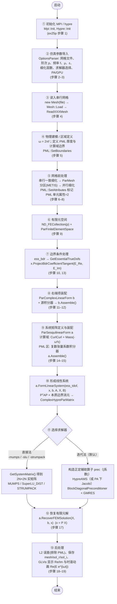
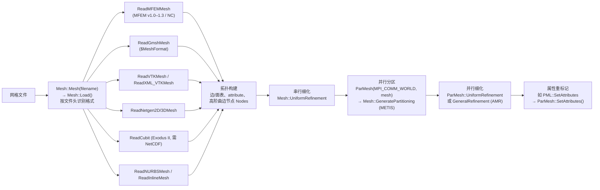
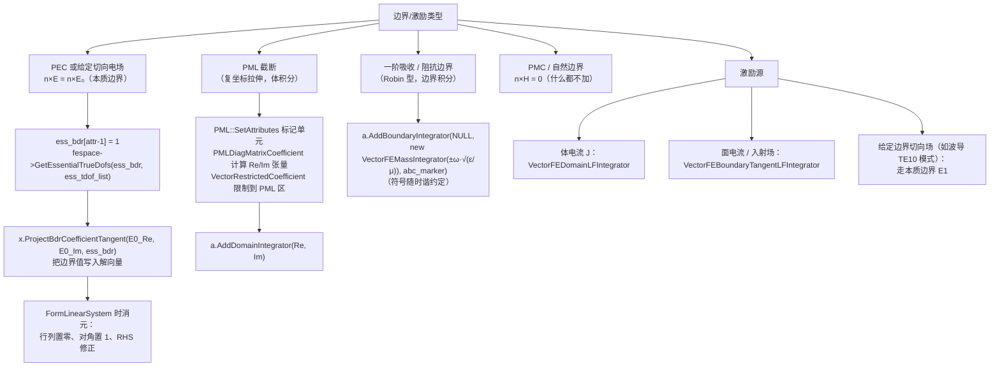
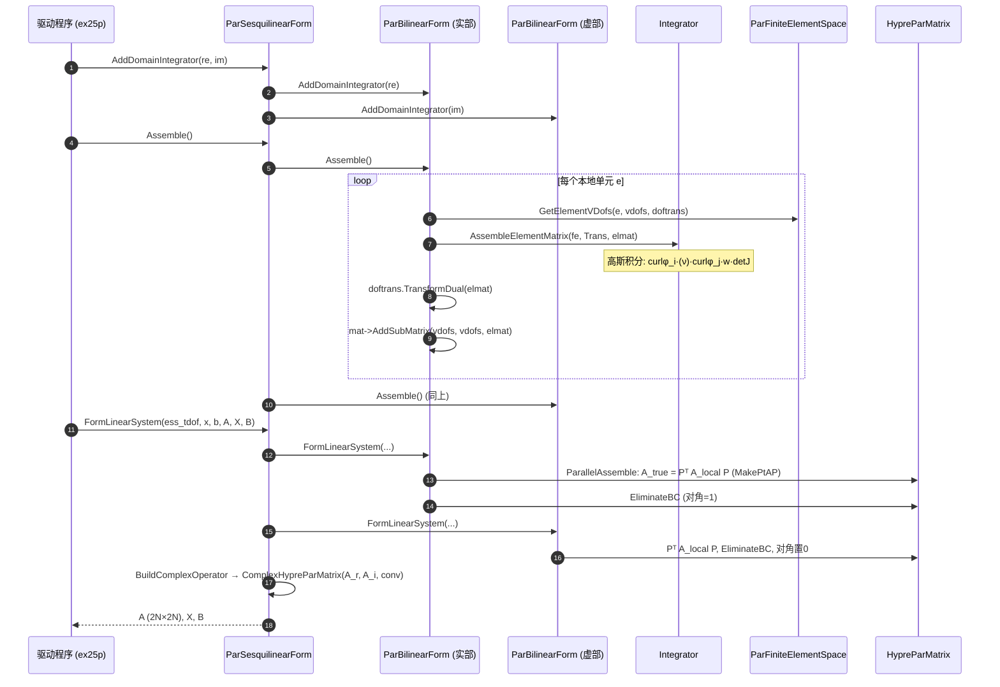
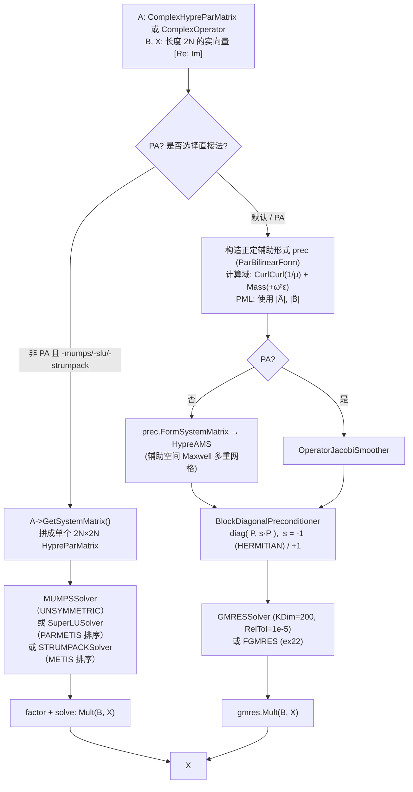
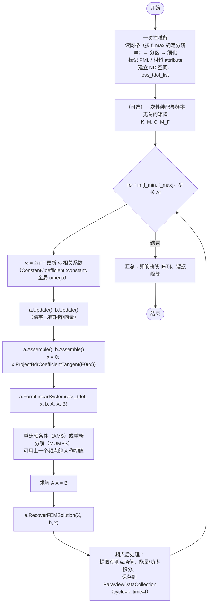
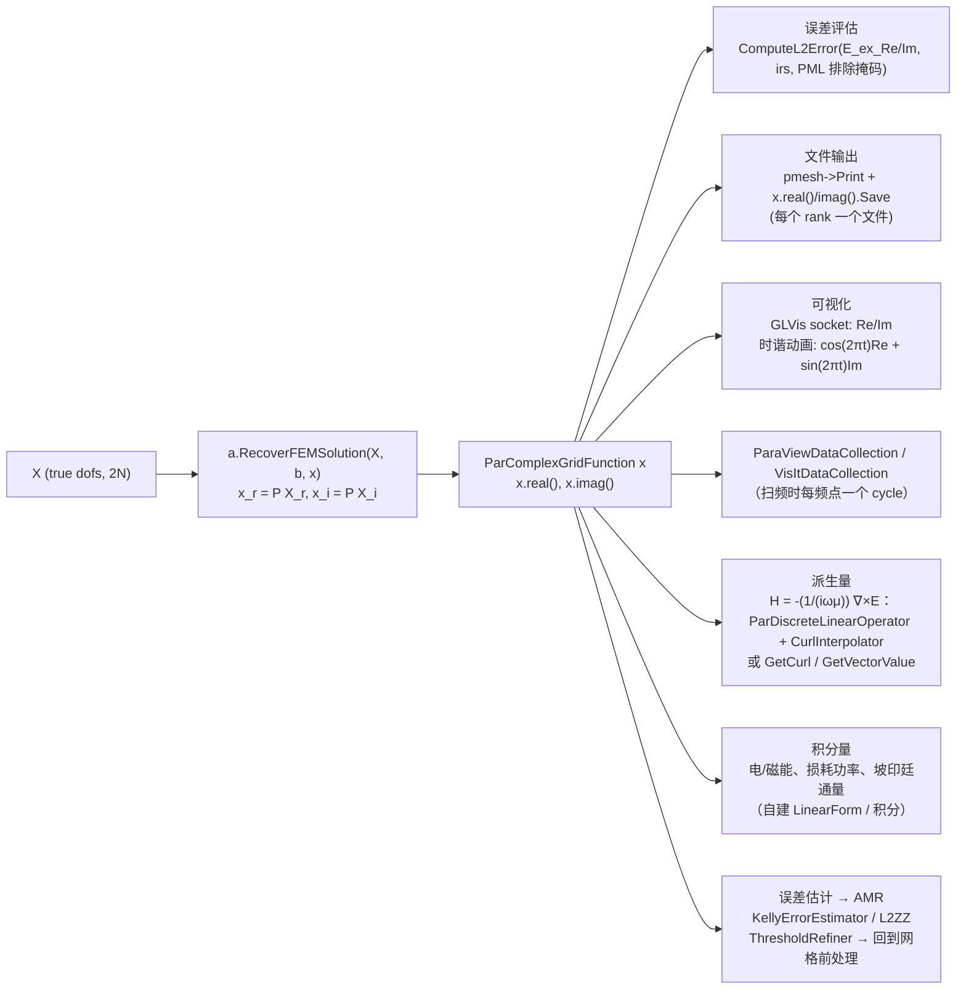

# MFEM 高频（时谐）电场求解架构与工作流程分析

> 适用代码版本：本仓库 `master`（MFEM 4.x 系列）。
> 关注点：频域 / 扫频电场计算——建模、参数导入、网格前处理、边界条件、矩阵组装、矩阵求解、后处理。

---

## 0. 先说结论

1. **MFEM 是一个通用有限元"库"，不是一个封装好的电磁仿真软件。** 仓库里没有一个叫"高频电场模块"的独立组件，高频电场（时谐 Maxwell）能力是由下面几部分**组合**出来的：
   - `fem/fe_coll.*`、`fem/fe/fe_nd.*`：Nédélec 棱边元（H(curl) 空间），用于离散电场 **E**；
   - `fem/bilininteg.*`：`CurlCurlIntegrator`（∇×∇× 项）和 `VectorFEMassIntegrator`（ω²ε 质量项 / iωσ 损耗项 / 阻抗边界项）；
   - `fem/complex_fem.*`：复数有限元封装 `ParSesquilinearForm`、`ParComplexLinearForm`、`ParComplexGridFunction`；
   - `linalg/complex_operator.*`：把复数系统表示为 2×2 实数块系统的 `ComplexOperator` / `ComplexHypreParMatrix`；
   - `linalg/hypre.*`、`linalg/mumps.*`、`linalg/superlu.*`、`linalg/strumpack.*`：AMS 预条件、GMRES、并行直接法。
2. **"驱动程序"在 `examples/` 和 `miniapps/` 里**，与高频电场相关的有：

   | 程序 | 方程 | 说明 |
   | --- | --- | --- |
   | `examples/ex25(p).cpp` | ∇×(1/μ ∇×E) − ω²εE = f，含 **PML** | **最接近"高频电场频域求解"的完整范例**，本文主线 |
   | `examples/ex22(p).cpp` | ∇×(a∇×E) − ω²bE + iωcE = 0 | 有耗（σ）时谐问题，演示复数形式和 `HERMITIAN/BLOCK_SYMMETRIC` 约定 |
   | `examples/ex13p.cpp` | ∇×(1/μ ∇×E) = λ εE | Maxwell 本征模（谐振腔模式），`HypreAME` |
   | `examples/ex3(p).cpp` | ∇×∇×E + E = f | 正定 Maxwell，入门用 |
   | `miniapps/dpg/pmaxwell.cpp` | 一阶时谐 Maxwell（Ultraweak DPG） | 稳定性更好、自带误差指示器 + AMR、含 PML |
   | `miniapps/electromagnetics/maxwell.cpp` | 时域 Maxwell（E–B 辛积分） | **时域**，对照用；其一阶吸收边界（ABC）写法可迁移到频域 |

3. **MFEM 核心库没有现成的"扫频"驱动、端口（Port）激励或 S 参数提取。** 扫频需要用户在驱动程序里写频率循环（本文第 9 节给出实现方式）。如果需要端口、S 参数、自适应快速扫频，可参考基于 MFEM 构建的 AWS 开源求解器 [Palace](https://github.com/awslabs/palace)。

---

## 1. 仓库分层架构



关键设计思想：

- **"Form + Integrator" 模式**：弱形式中的每一项对应一个 `Integrator` 对象，挂到 `BilinearForm` / `LinearForm` 上；Form 负责单元循环和全局装配，Integrator 只负责单元矩阵。
- **复数 = 两个实数 Form**：`ParSesquilinearForm` 内部持有 `pblfr`（实部）和 `pblfi`（虚部）两个 `ParBilinearForm`，所有复数操作都分解为实数操作（`fem/complex_fem.hpp` 第 979–1111 行）。
- **L-dof / T-dof 两级自由度**：本地（Local）自由度用于单元装配，真（True）自由度用于并行全局系统，二者通过延拓矩阵 `P` 和限制矩阵 `R` 转换（`A_true = Pᵀ A_local P`）。
- **装配级别可选**：`LEGACY / FULL / PARTIAL / ELEMENT / NONE`，`PARTIAL` 时可在 GPU 上做无矩阵算子运算（`-pa -d cuda`）。

---

## 2. 物理模型与离散形式

### 2.1 控制方程（时谐形式，损耗项写法与 ex22 一致）

\[
\nabla\times\left(\mu^{-1}\nabla\times \mathbf E\right) - \omega^2\varepsilon\,\mathbf E + i\omega\sigma\,\mathbf E = \mathbf f \quad \text{in } \Omega
\]

边界：\(\mathbf n\times\mathbf E = \mathbf n\times\mathbf E_0\)（PEC / 给定切向场），或阻抗/吸收边界，或用 PML 截断。

> MFEM 本身不强制时谐约定（\(e^{i\omega t}\) 或 \(e^{-i\omega t}\)），虚部各项的符号由驱动程序自行决定；损耗项、吸收边界项、PML 拉伸函数的虚部符号必须与所选约定一致。

### 2.2 弱形式（Nédélec 空间 \(V_h\subset H(\mathrm{curl})\)）

求 \(\mathbf E\in V_h\)，使对任意 \(\mathbf F\in V_h\)：

\[
(\mu^{-1}\nabla\times\mathbf E,\nabla\times\mathbf F) \;-\;\omega^2(\varepsilon\mathbf E,\mathbf F)\;+\;i\omega(\sigma\mathbf E,\mathbf F)\;[+\;i\omega\langle \eta^{-1}\,\mathbf n\times\mathbf E,\mathbf n\times\mathbf F\rangle_{\Gamma_{abc}}] = (\mathbf f,\mathbf F)
\]

对应 MFEM 积分器：

| 弱形式项 | 实部积分器 | 虚部积分器 |
| --- | --- | --- |
| \((\mu^{-1}\nabla\times E,\nabla\times F)\) | `CurlCurlIntegrator(1/μ)` | — |
| \(-\omega^2(\varepsilon E,F)\) | `VectorFEMassIntegrator(-ω²ε)` | — |
| \(i\omega(\sigma E,F)\) | — | `VectorFEMassIntegrator(ωσ)` |
| PML 内 \((\mu^{-1}\tilde{A}\nabla\times E,\nabla\times F)\) | `CurlCurlIntegrator(Re Ã)` | `CurlCurlIntegrator(Im Ã)` |
| PML 内 \(-\omega^2(\varepsilon\tilde{B}E,F)\) | `VectorFEMassIntegrator(Re B̃)` | `VectorFEMassIntegrator(Im B̃)` |
| 一阶吸收/阻抗边界 | — | `VectorFEMassIntegrator`（`AddBoundaryIntegrator`） |
| 体电流源 \((\mathbf f,F)\) | `VectorFEDomainLFIntegrator` | 同左 |
| 面电流源 | `VectorFEBoundaryTangentLFIntegrator` | 同左 |

其中 PML 张量（ex25 中的 `detJ_inv_JT_J_*`、`detJ_JT_J_inv_*`）：
\(\tilde A = \det(J)^{-1}J^TJ,\quad \tilde B=\det(J)\,(J^TJ)^{-1}\)，\(J\) 为复坐标拉伸 \(d_i(x)=1+i\,\frac{nc}{k L^n}|x-x_0|^{n-1}\) 的雅可比。

### 2.3 复数系统的实数化表示

\((A_r + iA_i)(x_r+ix_i) = b_r+ib_i\) 被写成 2N×2N 实数块系统（`linalg/complex_operator.hpp` 第 40–66 行）：

```text
HERMITIAN（默认）:          BLOCK_SYMMETRIC:
[ A_r  -A_i ] [x_r]   [ b_r]     [ A_r  -A_i ] [x_r]   [ b_r]
[ A_i   A_r ] [x_i] = [ b_i]     [-A_i  -A_r ] [x_i] = [-b_i]
```

当 \(A_r, A_i\) 都对称（有耗/PML 的典型情形）时，`BLOCK_SYMMETRIC` 使 2×2 块矩阵保持对称，便于用对称型求解器/预条件。ex25 用 `-herm / -no-herm` 选项切换。

---

## 3. 总体工作流程

下面以 `examples/ex25p.cpp`（并行版）为主线，右侧标注代码中的步骤编号。



---

## 4. 建模与仿真参数导入

### 4.1 参数导入

MFEM 示例程序**没有配置文件格式**，全部参数由命令行经 `OptionsParser`（`general/optparser.*`）解析：

```cpp
// examples/ex25p.cpp，第 180–219 行（有删节）
   OptionsParser args(argc, argv);
   args.AddOption(&mesh_file, "-m", "--mesh",
                  "Mesh file to use.");
   // ... order, prob, ref levels, mu, eps, freq, herm, solver flags ...
   args.AddOption(&device_config, "-d", "--device",
                  "Device configuration string, see Device::Configure().");
   args.Parse();
```

| 参数 | 含义 | 作用位置 |
| --- | --- | --- |
| `-m` | 网格文件 | 步骤 4 读入 |
| `-o` | Nédélec 元阶次 p | `ND_FECollection(order, dim)` |
| `-f` | 频率 (Hz)，ω = 2πf | 材料系数、PML 拉伸函数 |
| `-mu`, `-eps` | μ、ε（标量常数） | `ConstantCoefficient` |
| `-rs`, `-rp` | 串行/并行一致细化层数 | 步骤 6–7 |
| `-herm` | 复数约定 | `ComplexOperator::Convention` |
| `-mumps/-slu/-strumpack` | 直接求解器 | 步骤 16 |
| `-pa`, `-d cuda` | 部分装配 / GPU | `SetAssemblyLevel`、`Device` |

工程化时常见做法：自己写 JSON/YAML 读取（Palace 即如此），或把参数封装进一个 Solver 类（参考 `miniapps/electromagnetics/*_solver.hpp` 的写法）。

### 4.2 材料与区域建模

MFEM 用**单元属性（element attribute）**区分材料区域，用**边界属性（boundary attribute）**区分边界：

- 均匀材料：`ConstantCoefficient`；
- 分区常数材料：`PWConstCoefficient`（按 attribute 取值）；
- 空间变化/各向异性：`FunctionCoefficient`、`VectorFunctionCoefficient`、`MatrixFunctionCoefficient`，或自定义 `Coefficient::Eval`（ex25 的 `PMLDiagMatrixCoefficient`）；
- 区域限制：`RestrictedCoefficient` / `VectorRestrictedCoefficient` 让系数只在某些 attribute 上非零（ex25 用它把"计算域"和"PML 区"的积分器分开）。

```cpp
// examples/ex25p.cpp，第 429–458 行（有删节）
   ConstantCoefficient muinv(1_r / mu);
   ConstantCoefficient omeg(-pow2(omega) * epsilon);
   RestrictedCoefficient restr_muinv(muinv,attr);
   RestrictedCoefficient restr_omeg(omeg,attr);

   // Integrators inside the computational domain (excluding the PML region)
   ParSesquilinearForm a(fespace, conv);
   a.AddDomainIntegrator(new CurlCurlIntegrator(restr_muinv),NULL);
   a.AddDomainIntegrator(new VectorFEMassIntegrator(restr_omeg),NULL);
   // ... PML 区: 实部/虚部各一个积分器 ...
   a.AddDomainIntegrator(new CurlCurlIntegrator(restr_c1_Re),
                         new CurlCurlIntegrator(restr_c1_Im));
   a.AddDomainIntegrator(new VectorFEMassIntegrator(restr_c2_Re),
                         new VectorFEMassIntegrator(restr_c2_Im));
```

> 注意：MFEM 本身不提供 CAD 几何建模。几何与网格需在 Gmsh、Cubit、Netgen 等外部工具中完成，并在其中给体/面打上物理组编号（即 attribute）。

---

## 5. 网格读入与前处理



要点：

1. **格式识别**：`Mesh::Load` 读首行字符串判断格式（`mesh/mesh.cpp` 约 5120–5260 行），支持 MFEM 原生、Gmsh（`$MeshFormat`）、VTK legacy/XML、Netgen、TrueGrid、Cubit/Exodus、NURBS、内联网格。
2. **高频问题的网格分辨率**：一般要求每波长若干个单元（与阶次 p 相关）。ex25 只做一致细化；需要局部加密时可用 `GeneralRefinement` + 误差估计器（`KellyErrorEstimator`、`L2ZienkiewiczZhuEstimator`）+ `ThresholdRefiner`，DPG 版 `pmaxwell.cpp` 有完整 AMR 循环。
3. **并行分区**：`ParMesh` 构造时调用 `GeneratePartitioning`（默认 METIS），每个 rank 拿到一个子域及共享面/边/点信息。
4. **PML 区域标记**：ex25 的 `PML::SetAttributes` 遍历单元顶点，落在计算域外的单元属性设为 2，其余设为 1；同时把每个边界单元的属性设为唯一编号以便按几何位置选择 PEC 边界。

```cpp
// examples/ex25p.cpp，第 1059–1107 行（有删节）
void PML::SetAttributes(ParMesh *pmesh)
{
   // Initialize bdr attributes
   for (int i = 0; i < pmesh->GetNBE(); ++i)
   {
      pmesh->GetBdrElement(i)->SetAttribute(i+1);
   }
   // ... 若单元任一顶点在 comp_dom_bdr 之外, 则 attribute = 2 ...
   pmesh->SetAttributes();
}
```

### 5.1 有限元空间（自由度生成）

```cpp
// examples/ex25p.cpp，第 332–333 行（有删节）
   FiniteElementCollection *fec = new ND_FECollection(order, dim);
   ParFiniteElementSpace *fespace = new ParFiniteElementSpace(pmesh, fec);
```

- **Nédélec 元**保证切向连续、法向可跳变，天然满足电场界面条件，且避免伪解（spurious modes）。
- `ParFiniteElementSpace` 构建：本地 DOF 编号 → 共享实体上的 DOF 归属 → `Dof_TrueDof_Matrix`（即 `P`）。
- 高阶四面体/棱柱的 ND 元需要按面朝向修正基函数，由 `DofTransformation`（`fem/doftrans.*`）在装配时自动处理（见 `BilinearForm::Assemble` 中的 `doftrans.TransformDual(elmat)`）。

---

## 6. 边界条件与激励处理



### 6.1 本质边界（PEC / 给定切向场）

```cpp
// examples/ex25p.cpp，第 340–381 行（有删节）
   Array<int> ess_tdof_list;
   Array<int> ess_bdr;
   if (pmesh->bdr_attributes.Size())
   {
      ess_bdr.SetSize(pmesh->bdr_attributes.Max());
      ess_bdr = 1;
      // ... lshape / fichera 情形下按边界单元中心坐标挑选 ...
   }
   fespace->GetEssentialTrueDofs(ess_bdr, ess_tdof_list);
```

```cpp
// examples/ex25p.cpp，第 400–403 行（有删节）
   ParComplexGridFunction x(fespace);
   x = 0.0;
   VectorFunctionCoefficient E_Re(dim, E_bdr_data_Re);
   VectorFunctionCoefficient E_Im(dim, E_bdr_data_Im);
   x.ProjectBdrCoefficientTangent(E_Re, E_Im, ess_bdr);
```

在 ex25 的 `beam` 问题中，入口边界给定的 \(E_y=-i\frac{k}{\pi}\sin(\pi z)e^{ik_{10}x}\) 就是矩形波导 TE10 模式——相当于"给定场"形式的端口激励（不是匹配端口，不能提取 S 参数）。

### 6.2 复数本质边界的消元细节

`ParSesquilinearForm::FormLinearSystem`（`fem/complex_fem.cpp` 第 1956–2075 行）：

1. 分别对实部 Form、虚部 Form 调用 `ParBilinearForm::FormLinearSystem`，实部矩阵对角置 1、虚部矩阵对角置 0（`SetImaginaryEssentialDiagonalToZero`），这样 2×2 块系统在边界行上变成 `[I 0; 0 I]`；
2. 用 \(A_i x_i\)、\(A_i x_r\) 的消元贡献交叉修正 \(B_r, B_i\)；
3. 边界行 RHS 直接设为边界值 \(B = X\)；
4. `BLOCK_SYMMETRIC` 约定下对虚部 RHS 取反。

### 6.3 PML

- `PML::StretchFunction` 计算 \(d_i(x) = 1 + i\,\frac{n c}{k L^n}|x-x_0|^{n-1}\)（n=2, c=5），**依赖 ω**；
- 6 个辅助函数 `detJ_*` 返回张量对角元的实部、虚部、模；模值版本用于构造预条件算子；
- PML 外边界一般仍设为 PEC。

---

## 7. 矩阵组装

### 7.1 调用链



### 7.2 单元级：`CurlCurlIntegrator`

```cpp
// fem/bilininteg.cpp，第 2182–2251 行（有删节）
void CurlCurlIntegrator::AssembleElementMatrix
( const FiniteElement &el, ElementTransformation &Trans,
  DenseMatrix &elmat )
{
   // ...
   const IntegrationRule *ir = GetIntegrationRule(el, Trans);
   // 默认积分阶: Pk 空间 2p-2, 其他 2p
   elmat = 0.0;
   for (int i = 0; i < ir->GetNPoints(); i++)
   {
      const IntegrationPoint &ip = ir->IntPoint(i);
      Trans.SetIntPoint (&ip);
      w = ip.weight * Trans.Weight();
      el.CalcPhysCurlShape(Trans, curlshape_dFt);
      if (MQ)      { /* 矩阵系数 */ }
      else if (DQ) { /* 对角矩阵系数（PML 用这个） */ AddMultADAt(curlshape_dFt, D, elmat); }
      else if (Q)  { /* 标量系数 */ AddMult_a_AAt(w, curlshape_dFt, elmat); }
      else         { AddMult_a_AAt(w, curlshape_dFt, elmat); }
   }
}
```

`VectorFEMassIntegrator::AssembleElementMatrix`（同文件约 2649 行）结构相同，只是用 `CalcVShape` 代替 `CalcPhysCurlShape`。

### 7.3 全局级：单元循环与属性过滤

`BilinearForm::Assemble`（`fem/bilinearform.cpp` 第 456 行起）遍历单元，按 `domain_integs_marker` 过滤 attribute，累加各积分器的单元矩阵，再用 `AddSubMatrix` 加入本地稀疏矩阵。

### 7.4 并行级：Pᵀ A P

```cpp
// fem/pbilinearform.cpp，第 163–219 行（有删节）
void ParBilinearForm::ParallelAssemble(OperatorHandle &A, SparseMatrix *A_local)
{
   // ...
   dA.MakeSquareBlockDiag(pfes->GetComm(), pfes->GlobalVSize(),
                          pfes->GetDofOffsets(), A_local);
   // ...
   Ph.ConvertFrom(pfes->Dof_TrueDof_Matrix());
   A.MakePtAP(dA, Ph);
}
```

### 7.5 部分装配（PA / GPU）

`a.SetAssemblyLevel(AssemblyLevel::PARTIAL)` 后不生成稀疏矩阵，只在积分点存储几何/系数数据，`Mult` 时用张量积核在 CPU/GPU 上计算。此时 `FormLinearSystem` 返回的是 `ComplexOperator`（包裹 `ConstrainedOperator`），只能配迭代法和 Jacobi 类预条件，不能用直接法。

---

## 8. 矩阵求解



要点：

- **为什么不能直接用 AMS 解原系统**：高频 Maxwell 算子 \(K-\omega^2 M\) 是**不定**的，AMS 只适用于 \(\nabla\times\nabla\times + \beta I\)（β>0）这类正定 H(curl) 问题。所以 ex25/ex22 把质量项符号"翻正"（并对 PML 系数取模）构造一个正定近似算子，用它的 AMS 作预条件——这是"shifted/absolute-value preconditioner"思路。
- **频率越高，迭代法越难收敛**（GMRES 迭代数随 ω 和网格规模上升），这时通常改用直接法（ex25p 的 `-mumps`/`-slu`/`-strumpack`），或更高级的区域分解/扫掠类预条件。
- **直接法接口**：`ComplexHypreParMatrix::GetSystemMatrix()`（`linalg/complex_operator.hpp` 第 294 行）把两个实块拼成一个大实矩阵交给 MUMPS 等。仓库中也有串行的 `ComplexUMFPackSolver`。

```cpp
// examples/ex25p.cpp，第 472–485 行（有删节）
#ifdef MFEM_USE_SUPERLU
   if (!pa && slu_solver)
   {
      // Transform to monolithic HypreParMatrix
      HypreParMatrix *A = Ah.As<ComplexHypreParMatrix>()->GetSystemMatrix();
      SuperLURowLocMatrix SA(*A);
      SuperLUSolver superlu(MPI_COMM_WORLD);
      superlu.SetPrintStatistics(false);
      superlu.SetSymmetricPattern(false);
      superlu.SetColumnPermutation(superlu::PARMETIS);
      superlu.SetOperator(SA);
      superlu.Mult(B, X);
      delete A;
   }
#endif
```

```cpp
// examples/ex25p.cpp，第 574–586 行（有删节）
      BlockDiagonalPreconditioner BlockDP(offsets);
      BlockDP.SetDiagonalBlock(0, pc_r.get());
      BlockDP.SetDiagonalBlock(1, pc_i.get());

      GMRESSolver gmres(MPI_COMM_WORLD);
      gmres.SetPrintLevel(1);
      gmres.SetKDim(200);
      gmres.SetMaxIter(pa ? 5000 : 2000);
      gmres.SetRelTol(1e-5);
      gmres.SetAbsTol(0.0);
      gmres.SetOperator(*Ah);
      gmres.SetPreconditioner(BlockDP);
      gmres.Mult(B, X);
```

---

## 9. 扫频计算

### 9.1 哪些量依赖频率

| 对象 | 是否依赖 ω | 说明 |
| --- | --- | --- |
| 网格、ParMesh 分区、PML 属性标记 | 否 | 只做一次（除非按最高频率决定网格密度） |
| `ND_FECollection` / `ParFiniteElementSpace` | 否 | 只做一次 |
| `ess_tdof_list` | 否 | 只做一次 |
| \(K=(\mu^{-1}\nabla\times\cdot,\nabla\times\cdot)\)（非 PML 区） | 否 | 可只装配一次 |
| \(M=(\varepsilon\cdot,\cdot)\)、\(C=(\sigma\cdot,\cdot)\) | 否 | 可只装配一次，系数 \(-\omega^2\)、\(\omega\) 在外面乘 |
| PML 区的 \(\tilde A(\omega),\tilde B(\omega)\) | **是** | 拉伸函数含 \(k=\omega\sqrt{\varepsilon\mu}\)，需每个频点重新装配 |
| 吸收边界项 \(i\omega\langle\cdot\rangle\) | 是（线性） | 可装配 \(\langle\cdot\rangle\) 一次再乘 ω |
| 边界给定场 \(E_0(\omega)\)、源 f(ω) | 通常是 | 每个频点重新投影/装配 |
| 预条件 / 矩阵分解 | **是** | 每个频点重建（直接法需重新数值分解） |

### 9.2 扫频流程



### 9.3 在 ex25p 基础上改成扫频的代码骨架

以下为示意代码（未包含在仓库中），沿用 ex25p 里的对象名。由于 ex25p 的 `PML::StretchFunction` 与 PML 系数函数读取的是全局变量 `omega`，更新全局 `omega` 后重新 `Assemble()` 即可得到新频点的 PML 系数。

```cpp
// ---- 一次性准备: pmesh, pml, fespace, ess_tdof_list, conv 同 ex25p ----
ConstantCoefficient muinv(1.0 / mu);
ConstantCoefficient omeg(0.0);      // -omega^2*eps, 每个频点更新
ConstantCoefficient absomeg(0.0);   // +omega^2*eps, 预条件用
// ... 同 ex25p 构造 RestrictedCoefficient / PMLDiagMatrixCoefficient ...

ParSesquilinearForm a(fespace, conv);
// ... 同 ex25p 添加 4 组积分器 ...
ParBilinearForm prec(fespace);
// ... 同 ex25p 添加预条件积分器 ...
ParComplexLinearForm b(fespace, conv);
ParComplexGridFunction x(fespace);

ParaViewDataCollection pv("sweep", pmesh);
pv.RegisterField("E_re", &x.real());
pv.RegisterField("E_im", &x.imag());

for (int k = 0; k < nfreq; k++)
{
   real_t freq = f_min + k * df;
   omega = 2.0 * M_PI * freq;            // ex25p 中 PML 函数读取的全局量
   omeg.constant    = -omega * omega * epsilon;
   absomeg.constant =  omega * omega * epsilon;

   a.Update();  prec.Update();  b.Update();   // 清零上一频点的矩阵/向量
   b.Assemble();
   x = 0.0;
   x.ProjectBdrCoefficientTangent(E_Re, E_Im, ess_bdr);

   a.Assemble();
   OperatorPtr Ah;  Vector B, X;
   a.FormLinearSystem(ess_tdof_list, x, b, Ah, X, B);

   prec.Assemble();
   OperatorPtr PCOpAh;
   prec.FormSystemMatrix(ess_tdof_list, PCOpAh);
   HypreAMS ams(*PCOpAh.As<HypreParMatrix>(), fespace);
   ScaledOperator ams_i(&ams, conv == ComplexOperator::HERMITIAN ? -1.0 : 1.0);
   BlockDiagonalPreconditioner BDP(offsets);   // offsets 同 ex25p: {0, N, 2N}
   BDP.SetDiagonalBlock(0, &ams);
   BDP.SetDiagonalBlock(1, &ams_i);

   GMRESSolver gmres(MPI_COMM_WORLD);
   gmres.SetKDim(200); gmres.SetMaxIter(2000); gmres.SetRelTol(1e-6);
   gmres.SetOperator(*Ah); gmres.SetPreconditioner(BDP);
   gmres.Mult(B, X);   // 或改用 MUMPS: Ah.As<ComplexHypreParMatrix>()->GetSystemMatrix()

   a.RecoverFEMSolution(X, b, x);

   pv.SetCycle(k); pv.SetTime(freq); pv.Save();
   // 在此计算观测量: 点值(FindPoints/GetVectorValue)、能量积分、端口电压等
}
```

### 9.4 加速扫频的常用手段（需自行实现）

1. **矩阵复用**：对不含 PML 的问题，预先装配 \(K, M, C\) 三个 `HypreParMatrix`，每个频点用 `Add(1.0, K, -ω², M)` 组合实部，虚部为 \(\omega C\)，省去单元循环（注意本质边界消元要在组合之后统一做，或用 `EliminateRowsCols` 分别处理后小心对角项）。
2. **初值延拓**：用上一个频点的解作为 GMRES 初值（`gmres.iterative_mode = true`）。
3. **直接法复用符号分解**：相同稀疏结构下，只做数值分解（取决于所用的 MUMPS/STRUMPACK 接口能力）。
4. **模型降阶（MOR）快速扫频**：在少数频点求全阶解，构造 Krylov/POD 投影基，在降阶空间中对密集频点求解。MFEM 不内置；Palace 的 adaptive frequency sweep 实现了这种方法，可以参考。
5. **频点级并行**：不同频点相互独立，可用 MPI 子通信器按频点并行。

---

## 10. 后处理



- ex25p 中计算误差时传入 `pml->GetMarkedPMLElements()` 作为单元掩码，只在物理计算域统计误差；
- 时谐动画：ex25p 每帧计算 `x_t = cos(2πt)·x.real() + sin(2πt)·x.imag()`，即 \(\mathrm{Re}\{\mathbf E\,e^{-i2\pi t}\}\)，t 为以周期 T 归一化的时间；
- 磁场 H 可由离散旋度算子获得：在 RT 空间（3D）或 L2 空间（2D）上建立 `ParDiscreteLinearOperator(ND→RT)`，加 `CurlInterpolator`，再乘以 \(-1/(i\omega\mu)\)。

---

## 11. 核心类与文件速查

| 流程阶段 | 关键类 / 函数 | 文件 |
| --- | --- | --- |
| 参数解析 | `OptionsParser` | `general/optparser.*` |
| 网格读入 | `Mesh::Load`, `ReadGmshMesh`, `ReadVTKMesh`, `ReadCubit` … | `mesh/mesh.cpp`, `mesh/mesh_readers.cpp`, `mesh/gmsh.cpp` |
| 分区/细化 | `ParMesh`, `Mesh::GeneratePartitioning`, `UniformRefinement`, `GeneralRefinement` | `mesh/pmesh.*`, `mesh/mesh.cpp` |
| 有限元空间 | `ND_FECollection`, `ParFiniteElementSpace`, `DofTransformation` | `fem/fe_coll.*`, `fem/pfespace.*`, `fem/doftrans.*` |
| 本质边界 | `GetEssentialTrueDofs`, `ProjectBdrCoefficientTangent` | `fem/pfespace.cpp`, `fem/complex_fem.cpp` |
| 材料/PML 系数 | `ConstantCoefficient`, `RestrictedCoefficient`, `VectorRestrictedCoefficient`, 自定义 `VectorCoefficient` | `fem/coefficient.*`, `examples/ex25p.cpp` |
| 积分器 | `CurlCurlIntegrator`, `VectorFEMassIntegrator`, `VectorFEDomainLFIntegrator`, `VectorFEBoundaryTangentLFIntegrator` | `fem/bilininteg.*`, `fem/lininteg.*` |
| 复数装配 | `ParSesquilinearForm::{Assemble, FormLinearSystem, RecoverFEMSolution}` | `fem/complex_fem.cpp` |
| 实数装配 | `BilinearForm::Assemble`, `ParBilinearForm::{ParallelAssemble, FormLinearSystem}` | `fem/bilinearform.cpp`, `fem/pbilinearform.cpp` |
| 复数算子 | `ComplexOperator`, `ComplexHypreParMatrix::GetSystemMatrix` | `linalg/complex_operator.*` |
| 预条件/迭代 | `HypreAMS`, `BlockDiagonalPreconditioner`, `GMRESSolver`, `FGMRESSolver` | `linalg/hypre.*`, `linalg/blockoperator.*`, `linalg/solvers.*` |
| 直接法 | `MUMPSSolver`, `SuperLUSolver`, `STRUMPACKSolver`, `ComplexUMFPackSolver` | `linalg/mumps.*`, `linalg/superlu.*`, `linalg/strumpack.*`, `linalg/complex_operator.*` |
| 本征模 | `HypreAME` | `linalg/hypre.*`, `examples/ex13p.cpp` |
| 输出 | `ParaViewDataCollection`, `VisItDataCollection`, `socketstream` | `fem/datacollection.*`, `general/socketstream.*` |
| 误差/AMR | `KellyErrorEstimator`, `L2ZienkiewiczZhuEstimator`, `ThresholdRefiner` | `fem/estimators.*`, `mesh/mesh_operators.*` |

---

## 12. 与工程电磁软件相比的缺口

| 功能 | MFEM 现状 | 建议 |
| --- | --- | --- |
| CAD 建模 | 无 | Gmsh / Cubit / Netgen 建模剖分，用物理组编号作为 attribute |
| 配置文件 | 无（命令行） | 自定义 JSON/YAML 读取层 |
| 波端口 / 集总端口 / S 参数 | 无 | 自行实现端口模式求解（2D 本征问题）+ 边界积分；或参考 Palace |
| 扫频驱动 | 无 | 按第 9 节写频率循环，进阶可做 MOR |
| 吸收边界 | 无现成频域封装 | 一阶 ABC 用 `AddBoundaryIntegrator(NULL, VectorFEMassIntegrator)`；或 PML（ex25 / `miniapps/dpg/util/pml.*`） |
| 远场 / RCS | 无 | 在 Huygens 面上做近远场变换积分 |
| 高频大规模求解 | AMS 预条件对不定问题效果有限 | 并行直接法（MUMPS/STRUMPACK）或区域分解类预条件 |
