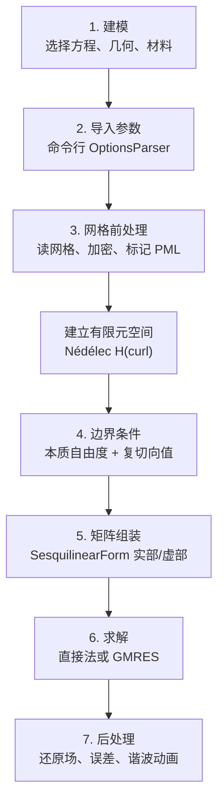
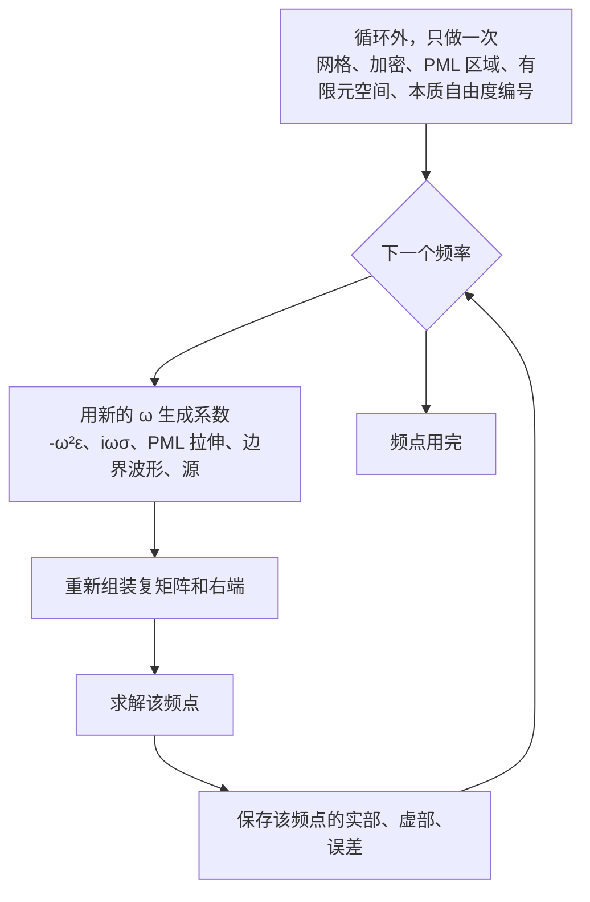
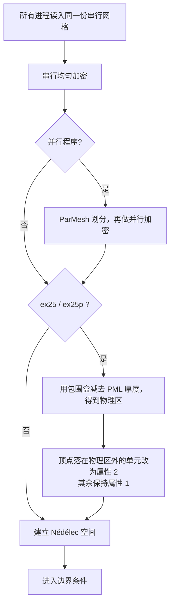
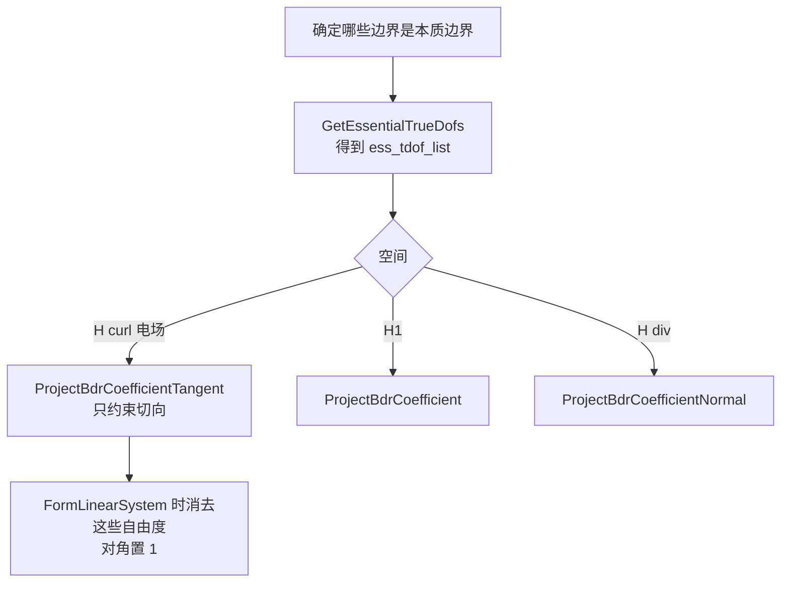
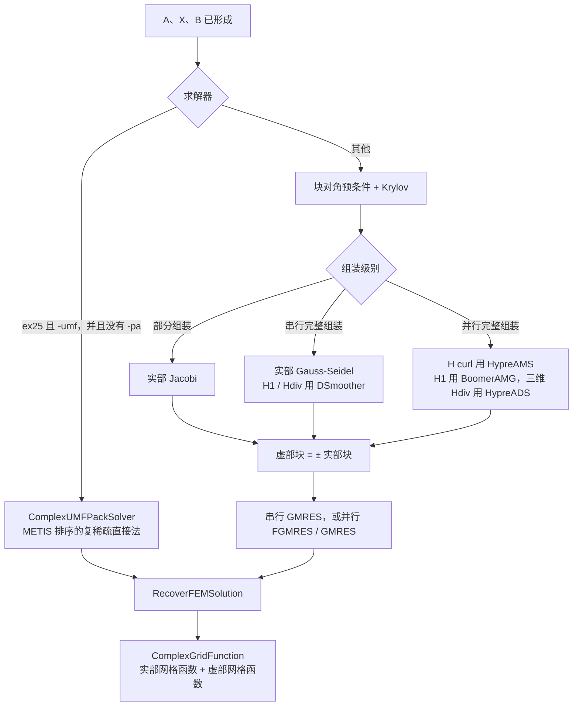
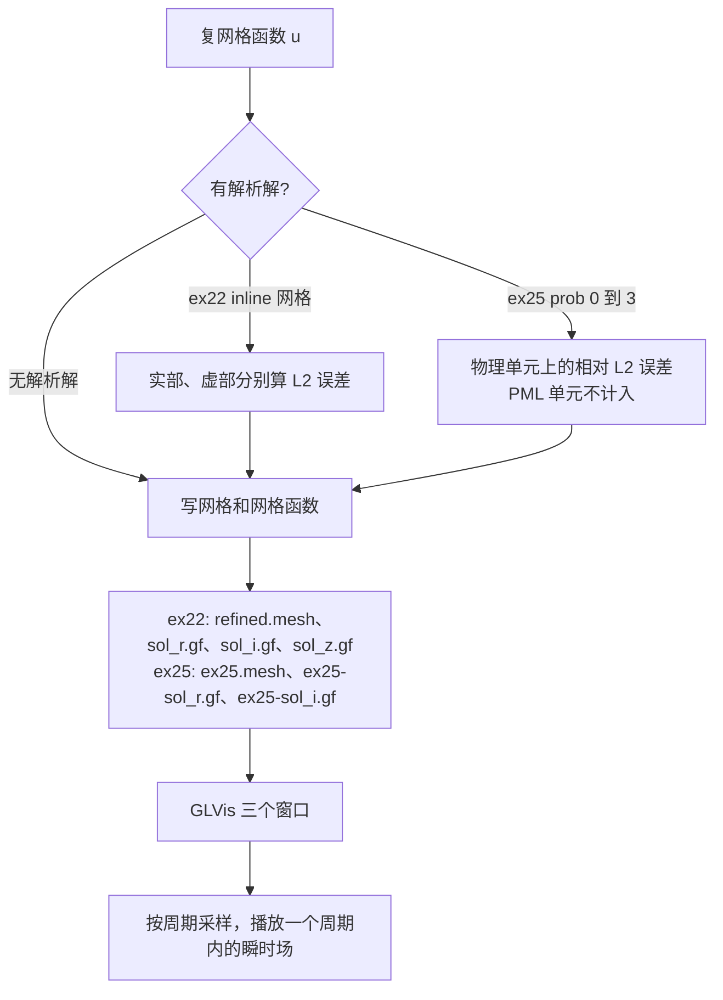

# 频域电场：从建模到后处理

仓库里的频域电场是复数谐波问题，一次运行解一个频率。入口有两条：

| 程序 | 方程 | 适用情况 |
| --- | --- | --- |
| `examples/ex22.cpp`，`-p 1` | `curl((1/μ) curl E) - ω² ε E + i ω σ E = 0` | 均匀介质、导电损耗、边界驱动 |
| `examples/ex25.cpp` | `(1/μ) curl curl E - ω² ε E = f` | 开域辐射，外层是笛卡尔 PML |

并行版本是 `ex22p.cpp`、`ex25p.cpp`。时域全波在 `miniapps/electromagnetics/maxwell.cpp`，那条路径不在本文范围。

仓库没有扫频循环。`-f` 只传入一个赫兹数。扫频要把含 `ω` 的系数、边界值、组装、求解和后处理放进循环。网格、有限元空间、PML 区域标记和本质自由度编号与频率无关，留在循环外。

约定 `ω = 2 π f`。`ex22` 的缺省是 `f` 未给时 `ω = 10`；`ex25` 的缺省频率是 5 Hz。

## 1. 总流程



扫频时，虚线框里的对象随频率变化，框外的对象只建一次。



PML 的拉伸函数里含有波数 `k = ω √(ε μ)`，所以换频率时 PML 系数也要重算，不能只改质量项。

## 2. 建模

两条程序都把电场放在 H(curl) 上，用 Nédélec 棱元。未知量是复相量 `E = Er + i Ei`，物理场由相量还原，见第 8 节。

`ex22 -p 1` 是有耗介质中的强迫振荡。刚度、质量和损耗都是常数：

```text
curl((1/μ) curl E) - ω² ε E + i ω σ E = 0
```

右端为零，激励来自边界上的切向电场。同一文件里 `-p 0` 是标量 H1，`-p 2` 是 H(div)，组装骨架相同，电场计算用 `-p 1`。

`ex25` 是无耗不定 Maxwell 方程，计算域外面垫一层 PML。物理区系数是实数；PML 里把坐标拉伸进复数，刚度项和质量项因此同时出现实部和虚部。

```text
物理区:  (1/μ) (curl E, curl F) - ω² ε (E, F)
PML 区:  (1/μ) (J̃ curl E, curl F) - ω² ε (Ĵ E, F)
```

`J` 是拉伸映射的雅可比。代码里刚度系数是 `Jᵀ J / det(J)` 的对角形式，质量系数是 `det(J) (Jᵀ J)⁻¹`。

几何由问题编号选好，也可以用 `-m` 换成自己的网格。

| `-prob` | 几何 | 已知解 | PML |
| --- | --- | --- | --- |
| 0 `beam` | `beam-hex.mesh` | 波导 T10 模 | 出口方向厚度 2 |
| 1 `disc` | `square-disc.mesh` | 二维点源 Hankel 函数 | 四边各 0.2 |
| 2 `lshape` | `l-shape.mesh` | 点源 | 左侧、下侧各 0.1 |
| 3 `fichera` | `fichera.mesh` | 三维点源 | 三个正方向各 0.5 |
| 4 缺省 | `inline-quad.mesh` 或 `-m` | 无 | 四周各 0.25，右端为高斯近似点源 |

## 3. 仿真参数导入

参数全部来自命令行，`OptionsParser` 解析后立刻打印。没有单独的参数文件。

电场计算常用的参数：

| 参数 | `ex22` | `ex25` | 进入方程的方式 |
| --- | --- | --- | --- |
| `-f` | 频率 Hz，缺省走 `ω=10` | 频率 Hz，缺省 5 | `ω = 2 π f` |
| `-mu` | 磁导率，缺省 1 | 同左 | 刚度系数 `1/μ` |
| `-eps` | 介电常数，缺省 1 | 同左 | 质量系数 `-ω² ε` |
| `-sigma` | 电导率，缺省 20 | 无 | 损耗系数 `ω σ`，只进虚部 |
| `-o` | 多项式阶，缺省 1 | 同左 | Nédélec 阶 |
| `-r` / `-ref` | 均匀加密次数 | 同左，缺省 3 | 网格前处理 |
| `-herm` | 缺省 Hermitian | 同左 | 复矩阵的 2×2 块约定 |
| `-pa` | 部分组装 | 同左 | 矩阵不落地成稀疏阵 |
| `-umf` | 无 | 需要 SuiteSparse | 复稀疏直接法 |
| `-m` | 网格文件 | 网格文件 | 覆盖内置几何 |

材料名和弹簧名是同一组变量：`-a` 是刚度，内部换成 `μ = 1/a`；`-b`、`-c` 分别对应 `ε` 和 `σ`。

## 4. 网格前处理



标记发生在最终网格上。`ex25p` 先做串行加密、划分和并行加密，再调用 `PML::SetAttributes`。任一顶点超出物理区，整个单元属性改为 2，`elems` 中记 0。误差积分看到 0 就跳过该单元，PML 不进入误差。

并行程序随后使用 `ParFiniteElementSpace`、`ParSesquilinearForm` 和 hypre 矩阵。方程与串行版本相同。

## 5. 边界条件

未知量是复场，边界值分成实部和虚部，再投影到本质自由度。



`ex22` 把全部边界属性都标成本质边界。

- 网格文件名以 `inline-` 开头时，边界值是沿最后一个坐标传播的平面波 `exp(-i κ x)`，`κ = sqrt(μ ω (ε ω - i σ))`。H(curl) 只取第一个分量。
- 其他网格没有解析解，实部切向取常数 1，虚部取 0。

`ex25` 的规则按几何变化。

- `beam`、`disc` 和一般问题：全部外边界是本质边界。
- `lshape`、`fichera`：只把列出的那几张面标成本质边界，其余面保持自然边界。
- 边界函数先判断点是否落在 PML。PML 内返回 0。物理边界上，有解析解时填入该解的实部和虚部。

右端项：

- `ex22` 的 `ComplexLinearForm` 保持为 0，驱动完全来自边界。
- `ex25` 只有 `-prob 4` 在域内加源。源是高斯函数，宽度和波数成正比，并且只加在线性型的虚部。

## 6. 矩阵组装

复双线性型是 `SesquilinearForm`。它内部是两份实数 `BilinearForm`：一份装实部算子，一份装虚部算子。积分器的实部或虚部指针可以是空的，表示该项没有对应分量。

`ex22 -p 1` 的四项：

| 项 | 积分器 | 实部系数 | 虚部系数 |
| --- | --- | --- | --- |
| 刚度 | `CurlCurlIntegrator` | `1/μ` | 空 |
| 质量 | `VectorFEMassIntegrator` | `-ω² ε` | 空 |
| 损耗 | `VectorFEMassIntegrator` | 空 | `ω σ` |

`ex25` 用单元属性把积分限制在对应区域。属性 1 只用实系数；属性 2 的刚度和质量都提交实、虚两个积分器。PML 系数由 `StretchFunction` 在每个积分点现算：拉伸指数 `n = 2`，强度 `c = 5`，分母里有 `k = ω √(ε μ)`。

组装之后 `FormLinearSystem` 做三件事：施加本质边界、处理非协调约束、把实部和虚部打包成一个实数块算子。未知向量的布局是先全部实自由度，再全部虚自由度，长度是实自由度的两倍。

默认 `-herm` 使用 Hermitian 约定：

```text
| Ar  -Ai | | xr |   | br |
| Ai   Ar | | xi | = | bi |
```

`-no-herm` 使用块对称约定，矩阵向量乘出来的是共轭结果。导电损耗和 PML 的虚部都是对称实矩阵时，块对称约定让整个 2×2 系统保持对称。

`-pa` 时两份型都设成 `AssemblyLevel::PARTIAL`，不生成全局稀疏矩阵，求解器只通过算子作用访问它们。

预处理器是另一份实数型，不进入原方程。H(curl) 把质量项改成正号，用来改善不定算子的可解性：

```text
ex22:  curl((1/μ) curl) + ω² ε + ω σ
ex25:  curl((1/μ) curl) + ω² ε，PML 中系数取拉伸因子的模
```

## 7. 矩阵求解



迭代法的控制参数：

| 程序 | 算法 | 相对容差 | 最大迭代 |
| --- | --- | --- | --- |
| `ex22` | GMRES | `1e-12` | 1000 |
| `ex22p` | FGMRES | `1e-12` | 1000 |
| `ex25` | GMRES，子空间维数 200 | `1e-5` | 完整组装 2000，部分组装 5000 |
| `ex25p` | 并行 GMRES | 与 `ex25` 同一套设置 | 预条件换成 HypreAMS |

虚部预条件块不单独组装。Hermitian 约定下，电场问题把实部光滑器乘 `-1` 放到虚部块上。

直接法和部分组装不能同时打开：`-umf` 需要已经落地的 `ComplexSparseMatrix`。

## 8. 后处理



瞬时场由相量还原。`ex22` 用

```text
E(t) = cos(2π t) Er - sin(2π t) Ei
```

`ex25` 用

```text
E(t) = cos(2π t) Er + sin(2π t) Ei
```

动画固定 32 帧，`t` 是周期的分数，不是物理时间。GLVis 窗口分别显示实部、虚部，以及随 `t` 变化的瞬时场。`ex25` 的误差只在 `elems` 标记为物理区的单元上积分。

扫频时，每个频点至少留下这三样结果：频率、实部和虚部网格函数、该频点的 L2 误差或端口量。现有程序只把当前这一次运行写到固定文件名，循环扫频时要自己改文件名，否则后一个频点会覆盖前一个。

## 9. 阅读顺序

1. `ex22.cpp` 文件头的三个算子，确认 `-p 1` 是电场。
2. `main` 里参数、空间、`ProjectBdrCoefficientTangent`。
3. `SesquilinearForm` 的两个 `AddDomainIntegrator`，对照实部和虚部系数。
4. `FormLinearSystem` 之后的 GMRES 块。
5. `u0_exact`，看边界平面波怎样依赖 `ω` 和 `σ`。
6. `ex25.cpp` 的 `PML::StretchFunction` 和两组 PML 积分器。
7. 需要并行时再看 `ex22p.cpp`、`ex25p.cpp` 里 HypreAMS 替换光滑器的那一段。
