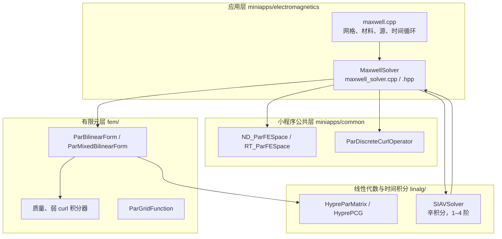
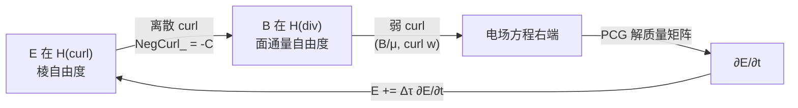
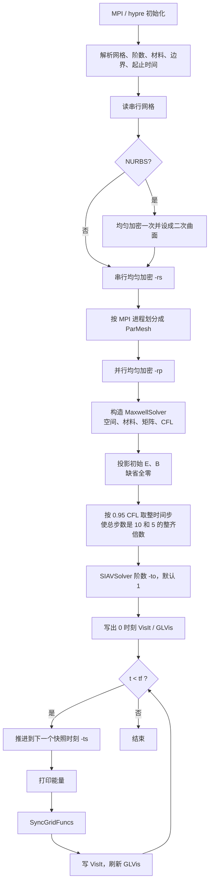
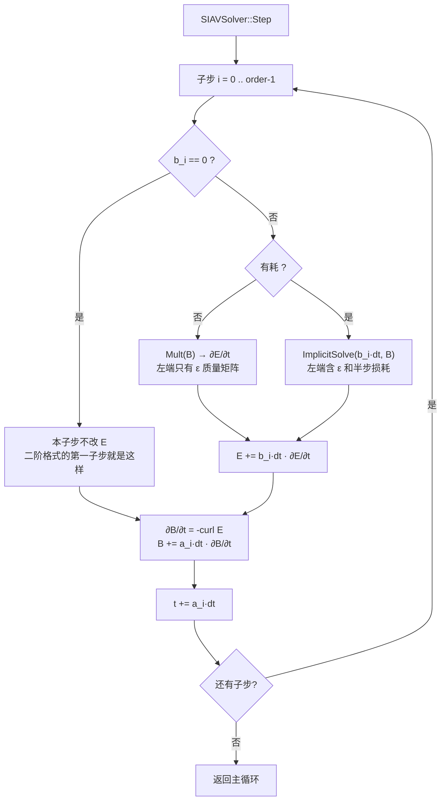
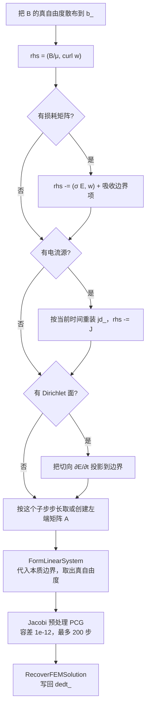
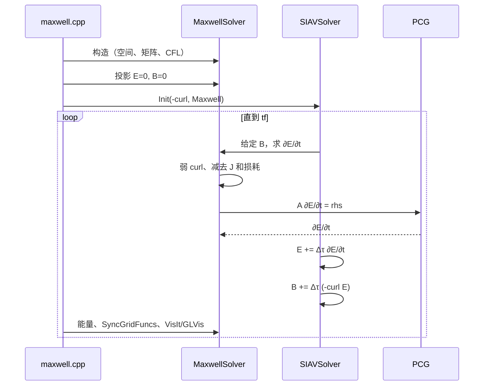

# 高频电场模块（Maxwell）架构与工作流程

本文说明 `miniapps/electromagnetics` 里的时域全波求解器。它是这组电磁小程序中的高频模块：电场和磁场互相耦合，随时间传播。静电场在 `volta`，静磁场在 `tesla`，准静态涡流和焦耳热在 `joule`。

频域谐波形式（`curl curl E - ω²ε E = f`）不在这个小程序里，对应的示例是 `examples/ex22.cpp` 和 `examples/ex25.cpp`。

## 1. 它在库里的位置

MFEM 自下而上分成四层。Maxwell 小程序只负责物理方程、材料、边界和时间循环，离散和线性代数都交给库。



并行前提是 MPI 和 hypre。`MaxwellSolver` 整段包在 `MFEM_USE_MPI` 里，单精度构建会直接跳过。

## 2. 连续方程

求解的是一阶 Maxwell 方程组，未知量是电场 `E` 和磁通密度 `B`：

```text
ε ∂E/∂t = curl(B / μ) - σ E - J
  ∂B/∂t = - curl E
```

| 符号 | 代码 | 缺省 |
| --- | --- | --- |
| `ε` | `epsCoef_` | 真空 `epsilon0_`，可用介质球覆盖 |
| `1/μ` | `muInvCoef_` | 真空 `1/mu0_`，可用磁壳覆盖 |
| `σ` | `sigmaCoef_` | 不导电；导电球内部为给定电导率 |
| `J` | `jCoef_` / `jd_` | 圆柱电流脉冲，时间包络是高斯导数 |
| `Y` | `etaInvCoef_` | 吸收边界导纳 `sqrt(ε0/μ0)` |

无耗时（没有电导、没有吸收边界）时间格式保持离散能量。有耗时，损耗项用梯形平均放到左端，能量只因物理损耗下降。

电磁能量为

```text
W = 1/2 ∫ ( ε |E|² + |B|² / μ ) dV
```

对应 `GetEnergy()`：`0.5 * (Eᵀ Mε E + Bᵀ M_{1/μ} B)`。

## 3. 离散空间

两个场放在兼容的 de Rham 序列上，多项式阶数来自命令行 `-so`。

| 场 | 空间 | 单元 | 构造 |
| --- | --- | --- | --- |
| `E`、`∂E/∂t`、`J` | H(curl) | Nédélec 棱元 | `ND_ParFESpace(mesh, order)`，内部是 `ND_FECollection(order)` |
| `B` | H(div) | Raviart–Thomas 面元 | `RT_ParFESpace(mesh, order)`，内部是 `RT_FECollection(order-1)` |

MFEM 的 RT 阶数比 ND 少 1，这样 `curl` 把 ND 自由度精确映到 RT 自由度。因此磁场更新不需要解线性方程组，只乘离散 curl。电场更新在弱形式下进行，左端是质量矩阵，必须求解。



## 4. 类怎么分工

`maxwell.cpp` 的 `main` 是驱动，不组装矩阵。

`MaxwellSolver` 继承 `TimeDependentOperator`。对辛积分器来说它是力算子 `F`：给定 `B`，算出 `∂E/∂t`。另一个算子 `P` 是 `GetNegCurl()`，给定 `E`，算出 `∂B/∂t = -curl E`。

`SIAVSolver`（`linalg/ode.cpp`）只知道这两个算子。它交替更新 `q = B` 和 `p = E`，不关心有限元。

```text
siaSolver.Init(Maxwell.GetNegCurl(), Maxwell);          // P = -curl, F = Maxwell
siaSolver.Run(Maxwell.GetBField(), Maxwell.GetEField(), t, dt, t_snapshot);
```

自由度有两份拷贝：

- `E_`、`B_` 是 hypre 真自由度，时间积分只改它们。
- `e_`、`b_` 是带共享自由度的网格函数，给局部矩阵乘、投影和可视化用。
- 快照前调用 `SyncGridFuncs()`，把真自由度散布回网格函数。

## 5. 主程序流程

入口是 `maxwell.cpp` 的 `main`。命令行时间用纳秒，进入求解器前乘 `tScale_ = 1e-9` 变成秒。



构造函数里一次做完、之后复用的东西：

1. 建 H(curl)、H(div) 并行空间。有电导或吸收边界时把算子标成 `IMPLICIT`，否则 `EXPLICIT`。
2. 材料系数：介电常数、磁导率倒数；按需再建电导率和吸收边界导纳。
3. Dirichlet 面（`-dbcs`）上取 H(curl) 真自由度 `dbc_dofs_`。边界值约束的是切向 `∂E/∂t`，缺省为 0。初始切向电场也是 0 时，这就是理想导体壁。
4. 组装 H(div) 质量矩阵 `M2MuInv_`，权是 `1/μ`。
5. 组装混合弱 curl：试验函数在 H(curl)，试探函数在 H(div)，积分 `(B/μ, curl w)`。
6. 若有耗，再组装损耗双线性型：体积分 `σ`，吸收面上边界质量 `Y`。
7. 组装离散 curl，整体乘 `-1` 得到 `NegCurl_`。
8. 电流源做成 `ParLinearForm`，每个子步按当前时间重装配。
9. 用幂迭代估计最大稳定时间步。

## 6. 一个时间步

`SIAVSolver::Step` 把一个整步拆成 `order` 个子步。系数 `a_[i]` 推进一步磁场，`b_[i]` 推进一步电场，子步之后时间增加 `a_[i] * dt`。实现依据 Candy 和 Rozmus 1991 年的可分哈密顿辛格式。

| 阶 | `a`（更新 B） | `b`（更新 E） | 结构 |
| --- | --- | --- | --- |
| 1 | `1` | `1` | 先电场，再磁场 |
| 2 | `1/2, 1/2` | `0, 1` | 半步磁场、整步电场、半步磁场 |
| 3 | `2/3, -2/3, 1` | `7/24, 3/4, -1/24` | 三阶辛格式 |
| 4 | Forest–Ruth 系数 | 同左，首项为 0 | 四阶辛格式 |

无耗时 `F` 是显式的，调用 `Mult`，它内部仍走 `implicitSolve(0, ...)`，只是左端没有损耗。有耗时调用 `ImplicitSolve(b_i * dt, B, dEdt)`，把这半个电步的步长送进左端矩阵。



磁场那一步没有求解。`NegCurl_` 是已组装的 hypre 矩阵，直接作用在电场真自由度上。

## 7. 电场子步里解什么

`implicitSolve` 是高频模块的核心。给定当前 `B` 和时间，求 `∂E/∂t`。



无耗左端是

```text
(ε ∂E/∂t, w) = (B/μ, curl w) - (J, w)
```

有耗时，电导和吸收边界用梯形法则。记本子步电场增量为 `Δτ = b_i dt`，则

```text
(ε ∂E/∂t, w) + (Δτ/2) (σ ∂E/∂t, w) + (Δτ/2) <Y ∂E/∂t, w>_Γ
    = (B/μ, curl w) - (σ E, w) - <Y E, w>_Γ - (J, w)
```

更新 `E ← E + Δτ ∂E/∂t` 之后，损耗项等价于用了 `(E_old + E_new) / 2`。代码里 `0.5 * dt` 就是这个 `Δτ/2`，见 `setupSolver`。

高阶格式的各个 `b_i dt` 不同，左端矩阵也不同。`setupSolver` 用

```text
idt = (int)(1e6 * dt / dtMax)
```

作键，把 `A1_`、对角预处理器和 `HyprePCG` 放进 `std::map`。无耗时键恒为 0，全程只有一个质量矩阵。`idt == 0` 时不把损耗加进左端，幂迭代和能量都使用这份纯介电质量矩阵。

质量矩阵条件数好，所以预处理器只是 hypre 对角缩放，没有 AMG。

三种边界的离散含义：

| 类型 | 命令行 | 离散处理 |
| --- | --- | --- |
| 自然边界 | 未列入 `-dbcs`、`-abcs` 的面 | 弱 curl 不产生边界积分，切向电流为 0 |
| 理想导体 | `-dbcs`，缺省 `dEdtBCFunc = 0` | 约束切向 `∂E/∂t`。初始切向 `E` 为 0 时等效 `n × E = 0` |
| 一阶吸收边界 | `-abcs` | Sommerfeld 条件，边界质量权为自由空间导纳 |

## 8. 时间步长

`GetMaximumTimeStep` 对下面这个算子做 20 次幂迭代，或直到相对变化小于 `0.001`：

```text
v  →  Mε⁻¹  Cᵀ  M_{1/μ}  C  v
```

最大特征值 `λ` 对应最高角频率的平方，稳定极限是 `dtMax = 2 / sqrt(λ)`。主程序再乘安全因子 `-sf`（默认 0.95），并用 `SnapTimeStep` 把步长稍微改小，使 `(tf - ti) / dt` 落在 1、2、5 乘 10 的幂这种步数上。

## 9. 一次运行里数据怎么走

以示例命令里的电流脉冲、介质球和吸收球为例：

```text
mpirun -np 4 maxwell -m ../../data/ball-nurbs.mesh -rs 2 \
  -abcs '-1' \
  -dp '-0.3 0.0 0.0 0.3 0.0 0.0 0.1 1 .5 .5'
```



电流只在圆柱棒内非零，方向沿棒轴。时间因子是

```text
a (t - b) exp( -0.5 ((t-b)/c)² ) / c²
```

`a、b、c` 在输入时是纳秒，函数内部乘 `tScale_`。这个脉冲的频谱决定了它是一个宽带高频源；网格加密和时间步必须跟得上脉冲宽度。

## 10. 建议的阅读顺序

1. `maxwell.cpp` 文件头的方程注释，再读 `main` 的时间循环。
2. `maxwell_solver.hpp` 的成员，对照第 4 节的矩阵。
3. `MaxwellSolver::MaxwellSolver` 的组装顺序。
4. `implicitSolve` 和 `setupSolver`，这是电场更新。
5. `linalg/ode.cpp` 里 `SIAVSolver::Step`，对照第 6 节的子步。
6. `GetMaximumTimeStep` 和 `GetEnergy`，确认 CFL 与能量用的是同一套矩阵。
